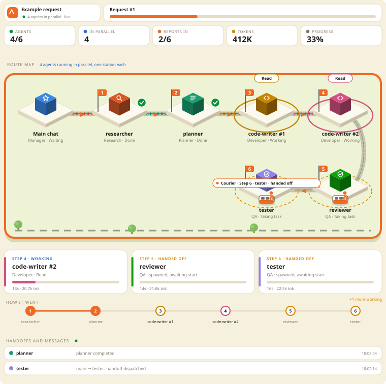
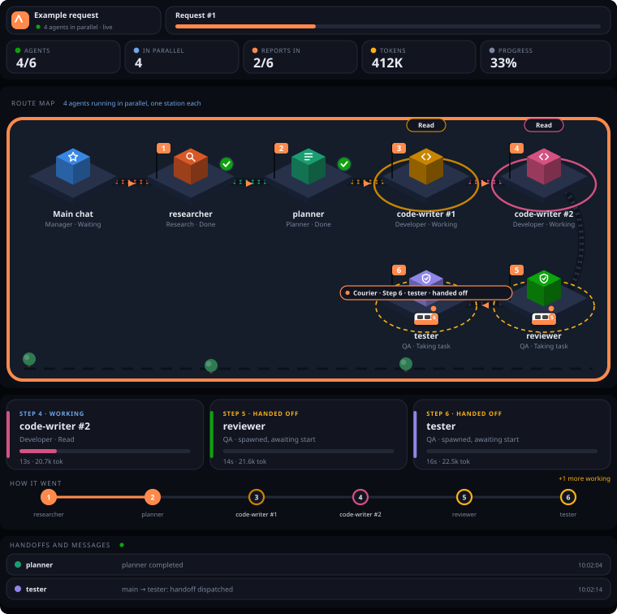
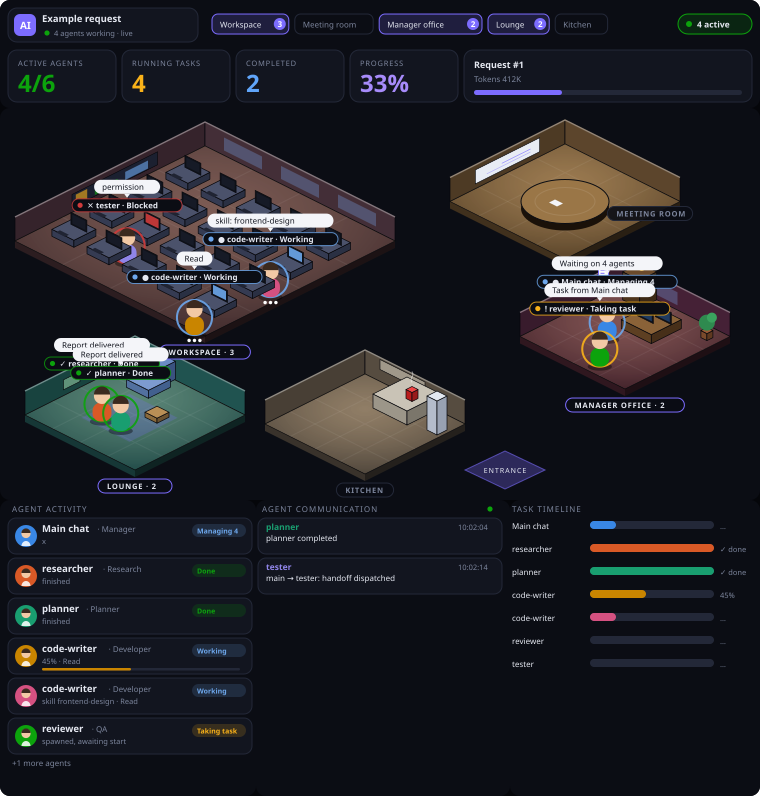
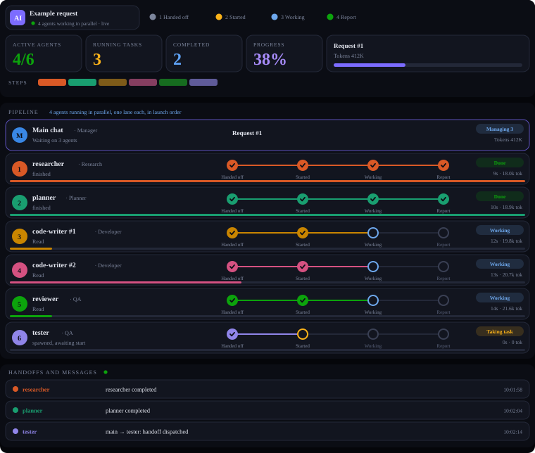

# Agent Command Center

A live control panel for [Claude Code](https://claude.com/claude-code) multi-agent work, built as a native Claude Code mod.

When Claude launches subagents, it is hard to see who is doing what, what was handed to whom, how many tokens each agent used, how much of your quota is left and when the work will finish. Agent Command Center shows all of it in one persistent pane, from the events Claude Code already emits.

**Route map** (light and dark looks): work travels along a rail to one station per agent, carried by a courier.





**Office** (isometric): rooms, desks with monitors, characters with name tags and a card per agent.



**Pipeline** (default): one lane per agent with its stages, progress, time and tokens.



## Highlights

- **Pipeline view (default):** one lane per agent, in launch order, with four stages (handed off, started, working, report delivered), its own progress bar, elapsed time and tokens. Agents that run in parallel each get a lane and are counted in the header.
- **Route map view:** the work travels along a rail from the main chat to one station per agent, in launch order. A courier carries each new handoff and a floating tag follows it; each parallel handoff gets its own courier. Step cards show the agents working now, and a stepper shows how the request went. Light (cream and orange) and dark looks.
- **Office view (desktop):** an isometric virtual office with five rooms (workspace, meeting room, manager office, lounge, kitchen). Each agent is a character with a name tag: it walks in from the entrance, takes the task from its parent, works at a desk whose monitor lights up in its state colour, hands the result back and rests. Tabs show which rooms are occupied, and a card strip lists every agent. A visual metaphor; every name, status and number is real.
- **Text view (terminal):** the same facts as plain text.
- **One chat, one flow:** each chat shows only the agents started in that chat, even while other chats run agents at the same time.
- **Numbers that matter:** tokens (total, per agent, per model, cache hit rate), 5-hour and weekly quota, context window, runtimes, ETAs with a confidence range, retries, stalled agents.
- **Handoff ledger:** a handoff counts as `returned` only when the destination's report arrives, never earlier.
- **14 slash commands** that print plain-text reports, with no model call.
- **Honest by design:** anything the host does not report is shown as "unavailable", and inferred values are labelled as inferred.

## It only watches

- **Zero extra model calls.** No monitoring agent, no summaries, no model-driven timers.
- **Never changes your session.** Hooks record an event and pass it straight through. Nothing is blocked, rewritten or denied, and permissions are never touched.
- **Private by default.** The default `strict` mode records no prompt, command, file path, output, error or task text. Only names, statuses, counts, tokens, quota and times. See [Privacy](mods/agent-command-center/docs/PRIVACY.md).
- **Local.** Nothing leaves your machine.

## Install

In Claude Code:

```
/plugin marketplace add Balajisecured-1/agent-command-center
/plugin install agent-command-center --marketplace Balajisecured-1/agent-command-center
```

Then run `/reload-plugins` (or start a new session). The **Agent Command Center** pane opens by itself on desktop. Requires Claude Code 2.1.275 or later.

To try it from a local clone without installing:

```
claude --plugin-dir ./mods/agent-command-center
```

## Quick start

1. Ask Claude for something that uses subagents, for example: *"Launch 3 general-purpose agents in parallel, each reading a different file, then summarise."*
2. Watch the pane: lanes appear as agents are handed work and fill as they run and report.
3. Switch the view with the **Pipeline / Route map / Office** buttons. Click an agent to see its details, or use the section buttons (Summary, Handoffs, Tokens, Quota, Time & ETA, History, Completion, Requests, Diagnostics).
4. Type `/agent-status` (or any command below) for the same information as text.

## Slash commands

| Command | Shows |
| --- | --- |
| `/agent-status` | Agents at a glance |
| `/agent-activity` | What each agent is doing right now |
| `/agent-handoffs` | Source → destination handoffs and their confirmed status |
| `/agent-progress` | Per-agent and overall completion |
| `/token-usage` | Tokens by total, agent and model; cache and retries |
| `/session-usage` | Session (5-hour) quota and context window |
| `/weekly-usage` | Weekly (7-day) quota |
| `/task-runtime` | Runtime of the current task and of each agent |
| `/request-runtime` | Runtime of the whole request |
| `/task-eta` | ETA of the current task |
| `/request-eta` | ETA of the entire request |
| `/agent-requests` | Per-request ledger: runtime, tokens, agents, retries |
| `/agent-diagnostics` | Which telemetry is real, which is missing, and how many events from other chats were ignored |
| `/execution-report` | Full execution report |

## Settings

Set in the plugin's settings (`userConfig`):

| Setting | Default | Meaning |
| --- | --- | --- |
| `privacy` | `strict` | `strict` records no free text. `standard` also records shortened text with secrets masked by pattern |
| `alerts` | on | Toasts for quota or context thresholds, failed agents and finished requests |
| `quotaWarn` | 80 | Warn when the 5-hour or weekly quota passes this percent |
| `ctxWarn` | 85 | Warn when the context window passes this percent |
| `animations` | on | Animate the office and the route map (couriers, pulses). Off gives a still frame |
| `officeWidth` | 900 | Drawn width in pixels. Lower it if the pane is narrow |

## Documentation

- [Usage guide](mods/agent-command-center/docs/USAGE.md): the pane, views, commands, alerts, troubleshooting
- [Data sources](mods/agent-command-center/docs/DATA-SOURCES.md): what is measured, from which event, and what is inferred or unavailable
- [Privacy and security](mods/agent-command-center/docs/PRIVACY.md): what is recorded in each mode, what stays on disk, limits
- [Architecture](mods/agent-command-center/docs/ARCHITECTURE.md): how the reducer, the views and the chat scoping work
- [Roadmap](mods/agent-command-center/docs/ROADMAP.md): what is planned next
- [Contributing](CONTRIBUTING.md): run the tests, add an event or a view
- [Changelog](mods/agent-command-center/CHANGELOG.md)
- [Security policy](SECURITY.md)

## Status and limits

- Verified with headless sessions (single agent, three parallel agents, two chats at once) and an automated suite (reducer scenarios, fuzzed streams, leak tests in both privacy modes, purity and speed checks, pane on terminal and desktop). The desktop pane has been checked by hand on one machine.
- Token counts are per turn, not per request. Quota appears only when the account reports it (subscription plans).
- In `standard` privacy mode, masking is pattern based: a short secret or a passphrase made of ordinary words can still be recorded. `strict` (the default) cannot record it.

## What's next

Planned: checking the desktop pane on more machines and long sessions, an independent security review, a license, real screenshots, continuous integration, stronger masking for `standard` mode, report export and better ETAs. Details and reasons are in the [roadmap](mods/agent-command-center/docs/ROADMAP.md).

## License

No license has been chosen yet. Until one is added, all rights are reserved by the author.
