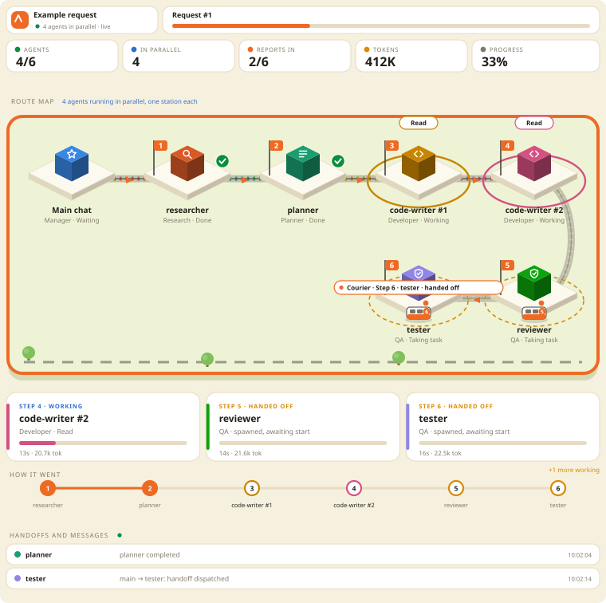
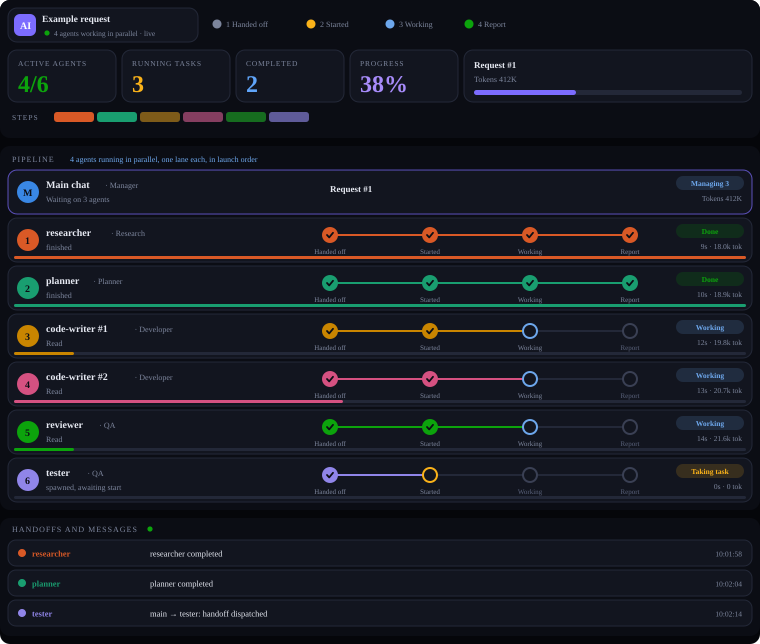

# Agent Command Center

A native Claude Code mod: a live, persistent pane that shows every agent, handoff, token count, quota window, runtime and ETA of the current chat. It only observes: zero extra model calls, nothing blocked or rewritten, private by default.





## Install

```
/plugin marketplace add Balajisecured-1/agent-command-center
/plugin install agent-command-center --marketplace Balajisecured-1/agent-command-center
```

Then `/reload-plugins`. The pane opens by itself.

## What you get

- **Pipeline view** (default): one lane per agent with four stages, progress, time and tokens. Parallel agents each get a lane.
- **Route map view:** work travels along a rail to one station per agent, carried by couriers; step cards and a stepper below. Light and dark looks.
- **Office view** (desktop): an animated office. Switch views with the buttons in the pane.
- **Text view** (terminal).
- **One chat, one flow:** a chat shows only its own agents, even while other chats run agents.
- **14 commands:** `/agent-status`, `/agent-activity`, `/agent-handoffs`, `/agent-progress`, `/token-usage`, `/session-usage`, `/weekly-usage`, `/task-runtime`, `/request-runtime`, `/task-eta`, `/request-eta`, `/agent-requests`, `/agent-diagnostics`, `/execution-report`.
- **Alerts** for quota, context, failed agents and finished requests.

## Settings

`privacy` (`strict` default or `standard`), `alerts`, `quotaWarn` (80), `ctxWarn` (85), `animations`, `officeWidth` (900).

## Docs

- [Usage guide](docs/USAGE.md)
- [Data sources](docs/DATA-SOURCES.md)
- [Privacy and security](docs/PRIVACY.md)
- [Architecture](docs/ARCHITECTURE.md)
- [Roadmap](docs/ROADMAP.md)
- [Changelog](CHANGELOG.md)

## Test

```
claude plugin validate .
claude plugin test .
```
